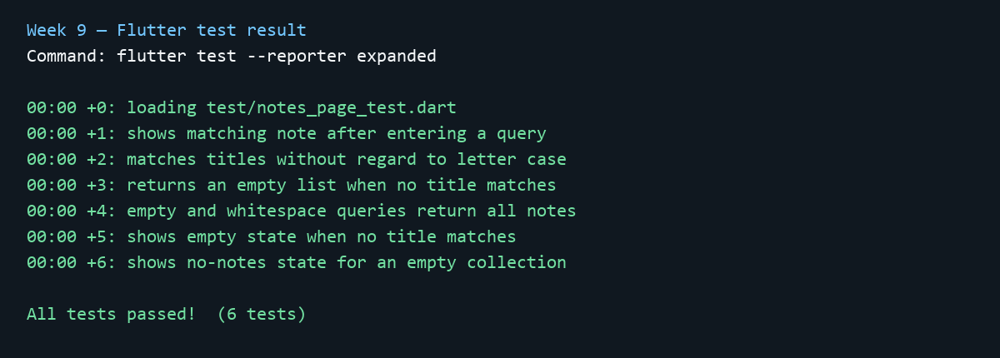

# Jobsheet: Matkul Mobile Development Week 9

| **Informasi** | **Detail** |
| --- | --- |
| Mata Kuliah | Mobile Development |
| Nama | Andhika Daffa Athaaillah |
| Absen | 02 |
| NIM | 244107020223 |
| Topik | AI-Assisted Development / Vibe Coding |

---

# Practicum

## Tujuan

- Mempraktikkan alur AI-assisted development: prompt, generate, verify, test, refactor, dan explain.
- Membuat pencarian judul catatan yang tidak peka huruf besar/kecil.
- Memisahkan aturan pencarian dari widget agar mudah diuji.
- Mencatat keputusan menerima/menolak usulan AI beserta bukti.

## Fitur yang dibuat

Aplikasi contoh **My Notes** menampilkan daftar catatan, kolom pencarian judul, hasil yang cocok, dan empty state berbeda untuk daftar kosong atau pencarian tanpa hasil. Pencarian mengabaikan kapitalisasi dan spasi di awal/akhir query.

## Struktur dan stack

- Flutter + Dart, Material 3
- `lib/features/notes/domain/`: model `Note` dan fungsi murni `filterNotes`
- `lib/features/notes/presentation/`: layar pencarian dan tampilan empty state
- `test/`: unit test filter dan widget test
- Data contoh disimpan di memori karena folder awal tidak menyediakan database atau repository.

## AI prompt dan keputusan

Prompt lengkap, konteks, ringkasan output awal, tabel accept/reject, bukti verifikasi, dan refleksi ada di [`docs/ai-log.md`](docs/ai-log.md).

Bug yang dibuktikan: pencarian yang hanya menurunkan huruf query namun tidak menurunkan huruf judul gagal untuk masukan dengan kapitalisasi berbeda. Test campuran `gRoC` menemukan kasus tersebut; filter final menormalkan keduanya.

## Test dan analisis

Jalankan dari folder proyek:

```bash
flutter pub get
dart format .
flutter test
flutter analyze
```

Hasil final:

- `flutter test --reporter expanded` — **All tests passed (6 tests)**
- `flutter analyze` — **No issues found**
- Screenshot hasil test: 

## Menjalankan aplikasi

```bash
flutter run
```

Coba query kosong, `FLUTTER` (hasil cocok), lalu `zzz-missing` (empty state pencarian). Untuk empty state daftar, gunakan daftar kosong pada `NotesPage`.

## Reflection

- **Hallucination/bug apa yang ditemukan dan bagaimana membuktikannya?** Perbandingan case-sensitive gagal pada input campuran kapitalisasi. Unit test membuktikan kegagalan lalu lulus setelah query dan judul sama-sama dinormalisasi.
- **Prompt mana yang paling membantu dan apa yang diubah?** Batas “cari judul saja”, “domain murni”, dan konteks bahwa tidak ada repository membantu menjaga implementasi tetap kecil dan sesuai struktur yang tersedia.
- **Refactor apa yang dilakukan?** Logika filter dipindahkan ke fungsi domain yang murni; widget hanya menyimpan query dan menampilkan hasil.
- **Keputusan accept/reject tersulit?** Tidak menambah Riverpod, SQLite, atau Dio tanpa kebutuhan/data-source yang tersedia pada folder ini.

---

# Assignment

Mini project Week 9 selesai: fitur search + empty state, prompt dan AI log, accept/reject dengan alasan teknis, unit/widget tests, serta bukti `flutter analyze` dan `flutter test` tersedia di folder ini.
