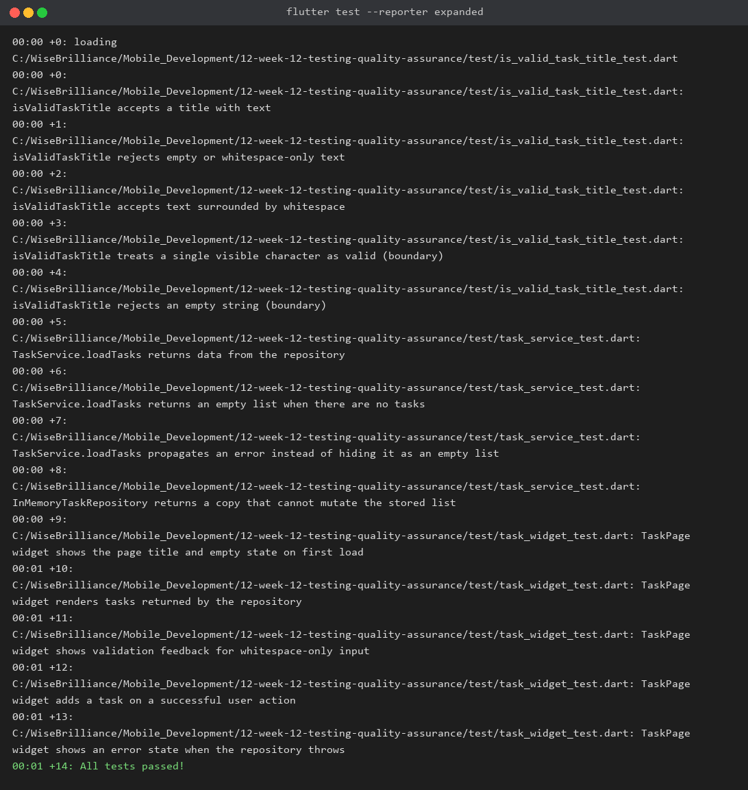
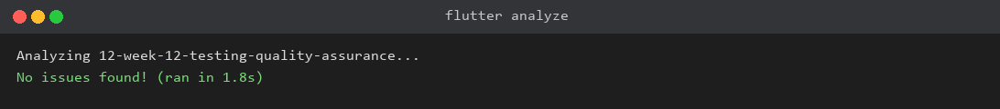
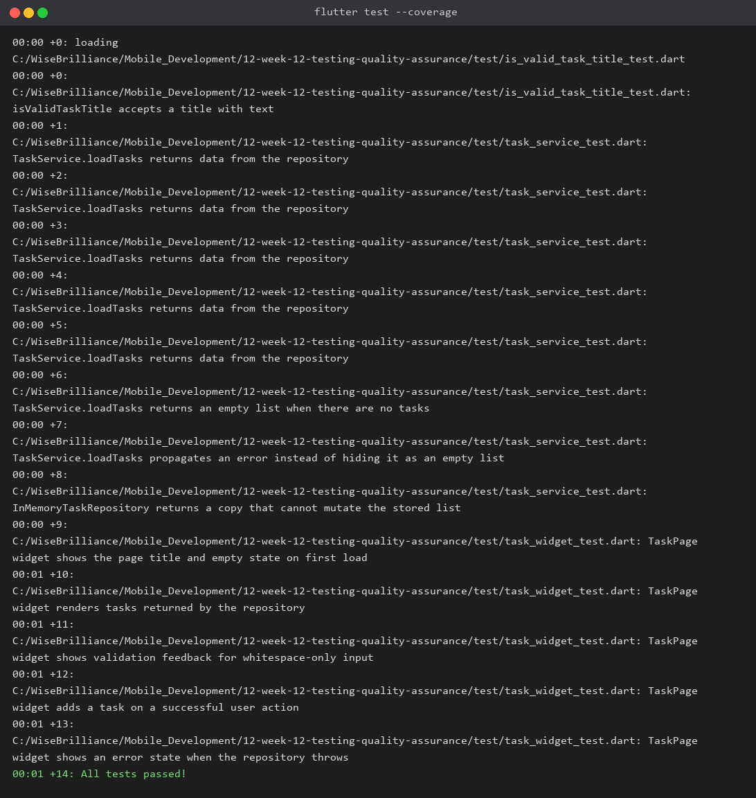
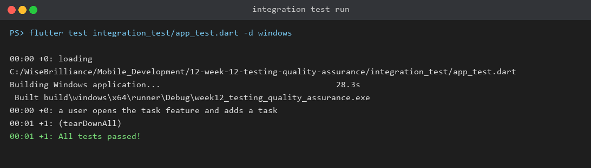
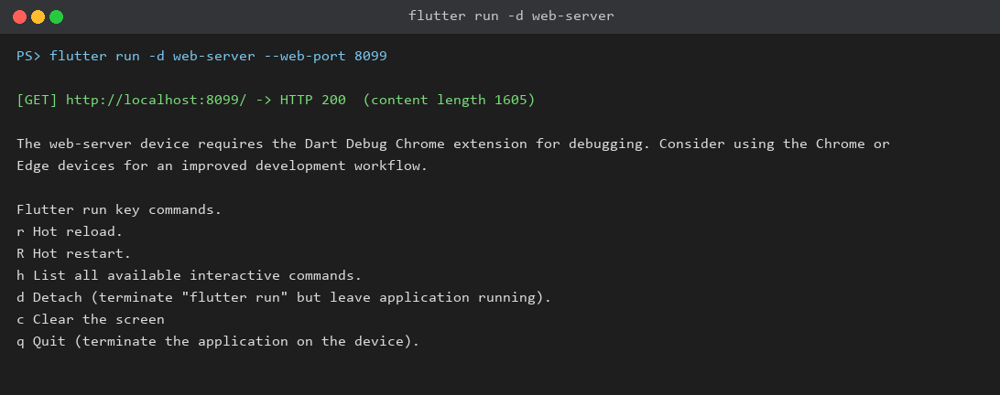

# Jobsheet: Matkul Mobile Development Week 12

| **Information** | **Detail** |
| --- | --- |
| Course | Mobile Development |
| Name | Andhika Daffa Athaaillah |
| Absen | 02 |
| NIM | 244107020223 |
| Topic | Testing & Quality Assurance |

---

# Practicum

## Objectives

- Choose between unit, widget, and integration tests for a feature.
- Write unit tests for logic and edge cases.
- Test Flutter widget output and user interactions.
- Separate dependencies so code is easier to test, including with a fake repository.
- Run integration tests and use code coverage as one way to assess the test suite.

## Feature built

This week continues the Week 11 project and adds a **task feature** to test. The app opens on a home screen with two entries:

1. **Task feature**: a list with a title field (key `task-title-field`) and a **Save task** button (key `save-task-button`). It shows loading, empty, error, and populated states, and rejects invalid input such as empty or whitespace-only titles.
2. **Performance lab**: carried over from Week 11, kept as a second feature so the suite covers more than one screen.

Data access goes through a `TaskRepository` abstraction. The running app uses an `InMemoryTaskRepository`; tests inject a fake to control success, empty, and failure behavior without a network.

## Testing strategy

| Type | What it checks | In this lab |
| --- | --- | --- |
| Unit | A function or object without rendering UI | `isValidTaskTitle`, `TaskService` over a fake repository |
| Widget | Output and interaction of widgets | Task page initial/empty/error, invalid input, successful add |
| Integration | An end to end flow on a device or emulator | `integration_test/app_test.dart`: open the feature, add a task, see it listed |

## Structure

- `lib/is_valid_task_title.dart`: pure validation rule, no widgets and no I/O.
- `lib/task_repository.dart`: the `TaskRepository` contract, `TaskService`, and `InMemoryTaskRepository`.
- `lib/task_page.dart`: task list UI with loading, empty, error, and list states.
- `lib/main.dart`: home screen that links the task feature and the performance lab.
- `lib/performance_lab_page.dart`: Week 11 screen, carried over.
- `test/`: unit tests, repository/service tests, and widget tests.
- `integration_test/app_test.dart`: main flow integration test.
- `coverage/`: real `lcov.info` plus a plain language summary.
- `screenshots/`: real terminal images of the commands below.

## Running the app

```bash
flutter pub get
flutter run
```

The codelab expects an emulator or connected device. No Android device or emulator is available in this environment, so the app is run on the web-server device and opened on localhost:

```bash
flutter run -d web-server --web-port 8099
# open http://localhost:8099/
```

This was verified here with HTTP 200. See [`screenshots/web-server-run.png`](screenshots/web-server-run.png).

## Tests, coverage, and analysis

Real results captured in this workspace:

```text
flutter test --reporter expanded                       All tests passed! (14 tests)
flutter test integration_test/app_test.dart -d windows All tests passed! (1 test)
flutter analyze                                        No issues found!
flutter test --coverage                                All tests passed! (14 tests) -> coverage/lcov.info
```

Terminal captures (real command output):

- [`screenshots/flutter-test-passed.png`](screenshots/flutter-test-passed.png)
- [`screenshots/flutter-analyze.png`](screenshots/flutter-analyze.png)
- [`screenshots/flutter-test-coverage.png`](screenshots/flutter-test-coverage.png)

### Test files

- `test/is_valid_task_title_test.dart`: valid title, empty, whitespace-only, surrounding whitespace, and boundary cases.
- `test/task_service_test.dart`: fake repository for success, empty, and error. The error test proves a failure is not silently turned into an empty list.
- `test/task_widget_test.dart`: initial/empty, populated list, invalid input feedback, successful add, and the repository error state.

## Coverage

`flutter test --coverage` produces `coverage/lcov.info`. Measured from the real report:

| File | Lines hit | Lines found | Coverage |
| --- | --- | --- | --- |
| `lib/is_valid_task_title.dart` | 2 | 2 | 100.0% |
| `lib/task_repository.dart` | 7 | 7 | 100.0% |
| `lib/task_page.dart` | 77 | 78 | 98.7% |
| **Total** | **86** | **87** | **98.9%** |

The tested feature (validation, repository, task page) is at or near 100%. Coverage shows which lines ran, not whether behavior is correct, so important branches and edge cases are covered with real assertions instead of assertion free tests. Details: [`coverage/README.md`](coverage/README.md).

## Integration and device run

No Android emulator or physical device is available in this environment, so the integration test runs on the Windows desktop device. Desktop support was added with `flutter create --platforms=windows .`, and the test passes for real:

```text
flutter test integration_test/app_test.dart -d windows
Building Windows application...  28.3s
Built build\windows\x64\runner\Debug\week12_testing_quality_assurance.exe
a user opens the task feature and adds a task
All tests passed!
```

The captured run is in [`screenshots/integration-run.png`](screenshots/integration-run.png). The test drives the full flow: open the task feature, enter a title, tap save, and confirm the task is listed.

To run it on an Android device or emulator instead:

```bash
flutter devices
flutter test integration_test/app_test.dart -d <device_id>
```

## Terminal evidence

All captures below show real command output from this workspace.







## Reflection

- **Which bug would have been easiest to miss without the tests?** The error path. Without the service test that asserts a thrown error is propagated, a `catch` that returned `[]` would look fine on screen but would silently render "No tasks yet" when loading actually failed. The widget error test pins that behavior to a visible state.
- **Where did a fake repository help?** In the unit and widget tests. It let the suite force an exception and an empty result on demand, with no network and no timing dependence, so the failure tests are fast and repeatable.
- **What did the widget and integration tests each tell you?** The widget tests confirmed the page's own states, validation, and list updates in isolation. The integration test drove the wider flow from home to task page to repository to list on the Windows desktop device and passed, confirming the pieces work together, not just alone.

---

# Assignment

Unit and widget tests for the task feature (success, invalid input, error), one integration test for the main flow that passes on the Windows desktop device, coverage from `flutter test --coverage`, real `flutter test`, integration test, and `flutter analyze` output, and real terminal captures are all in the Week 12 folder. Run `flutter test`, `flutter test integration_test/app_test.dart -d windows`, `flutter test --coverage`, and `flutter analyze` to reproduce, and `flutter run -d web-server --web-port 8099` to try the app on localhost.
