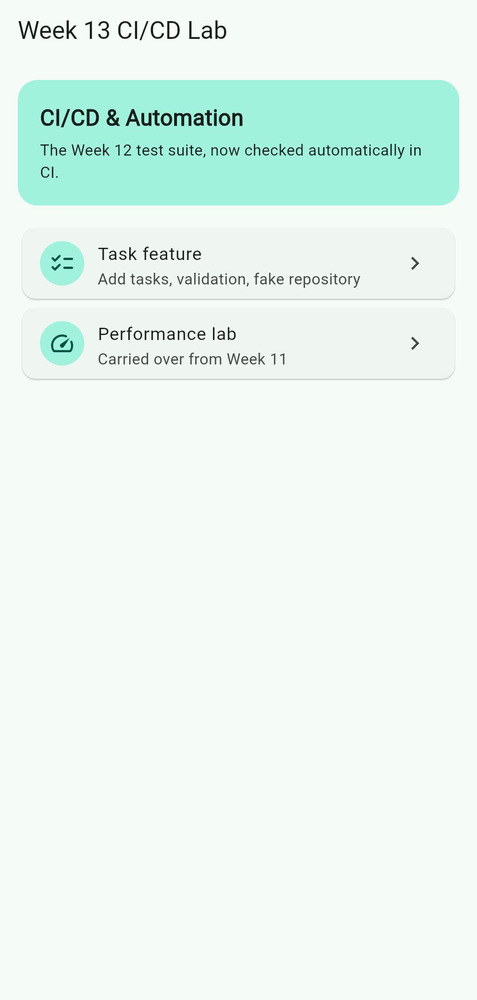
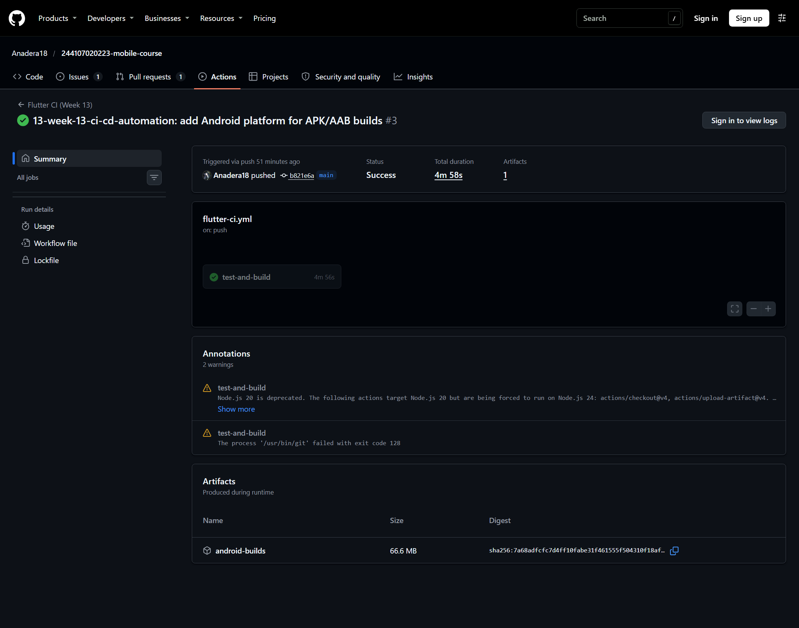
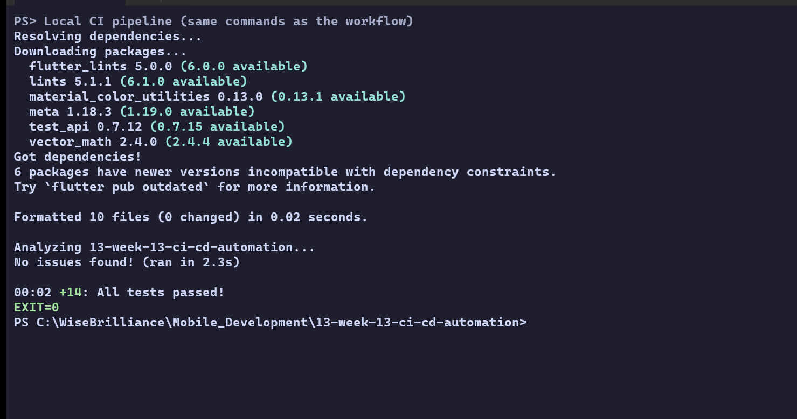
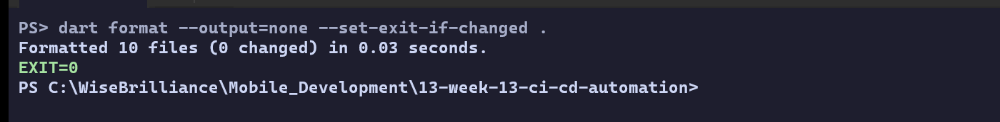
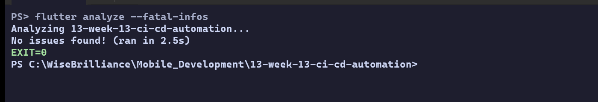
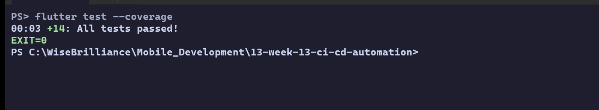
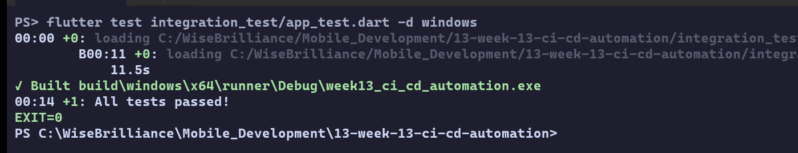

# Jobsheet: Mobile Development Course Week 13

| **Information** | **Detail** |
| --- | --- |
| Course | Mobile Development |
| Name | Andhika Daffa Athaaillah |
| Absen | 02 |
| NIM | 244107020223 |
| Topic | CI/CD & Automation |

---

# Practicum

## Objectives

- Explain the CI/CD flow from a commit to an application artifact.
- Create a workflow for formatting, analysis, tests, and Android builds.
- Store APK/AAB files as reviewable artifacts.
- Use versioning and understand the limits of secret storage.

## Feature built

This week continues the Week 12 project and puts it under automation. The app itself is unchanged in purpose: a **task feature** (validation, repository with loading/empty/error states) plus the **performance lab** carried over from Week 11. What is new is a **GitHub Actions pipeline** that formats, analyzes, tests, and builds this project automatically on every push and pull request, then stores the Android artifacts for review.

The pipeline implements continuous integration (CI) for the checks and continuous delivery (CD) preparation for the build artifacts. It does not publish to Google Play.



The home screen above is a real screenshot of the running app (captured from the browser via `flutter build web`), not a mock-up.

## Evidence at a glance

The pipeline is real: pushed to GitHub and green on the runner.



This is a real screenshot of the run page on github.com, captured from the browser.

The same checks pass locally before pushing:



## CI/CD flow

1. A push to `main`, a pull request, or a manual dispatch triggers the workflow.
2. The runner checks out the source and installs the pinned Flutter SDK.
3. Formatting, static analysis, and tests run.
4. If the checks pass, the app is built (APK and AAB) and the artifacts are uploaded.

## The workflow file

The workflow that GitHub actually runs lives at the **repository root** in [`.github/workflows/flutter-ci.yml`](../../.github/workflows/flutter-ci.yml); GitHub Actions only reads workflows from `.github/workflows/` at the repo root. Because this monorepo holds many week folders, the job uses `defaults.run.working-directory: 13-week-13-ci-cd-automation` so every command runs inside this week's project. An identical copy is kept next to this README at [`13-week-13-ci-cd-automation/.github/workflows/flutter-ci.yml`](.github/workflows/flutter-ci.yml) as the week deliverable.

```yaml
name: Flutter CI (Week 13)

on:
  push:
    branches: [main]
    paths:
      - '13-week-13-ci-cd-automation/**'
      - '.github/workflows/flutter-ci.yml'
  pull_request:
    branches: [main]
    paths:
      - '13-week-13-ci-cd-automation/**'
      - '.github/workflows/flutter-ci.yml'
  workflow_dispatch:

permissions:
  contents: read

concurrency:
  group: ${{ github.workflow }}-${{ github.ref }}
  cancel-in-progress: true

jobs:
  test-and-build:
    runs-on: ubuntu-latest
    defaults:
      run:
        working-directory: 13-week-13-ci-cd-automation
    steps:
      - uses: actions/checkout@v4
      - uses: subosito/flutter-action@v2
        with:
          flutter-version: 3.47.2
          channel: stable
          cache: true
      - run: flutter pub get
      - run: dart format --output=none --set-exit-if-changed .
      - run: flutter analyze --fatal-infos
      - run: flutter test --coverage
      - run: flutter build apk --release
      - run: flutter build appbundle --release
      - uses: actions/upload-artifact@v4
        with:
          name: android-builds
          path: |
            13-week-13-ci-cd-automation/build/app/outputs/flutter-apk/app-release.apk
            13-week-13-ci-cd-automation/build/app/outputs/bundle/release/app-release.aab
          if-no-files-found: error
          retention-days: 7
```

## Events and permissions

- `pull_request` checks changes before merge; `push` checks the `main` branch; `workflow_dispatch` allows a manual run.
- `permissions: contents: read` grants only what checkout needs. No write access is granted because nothing is written back to the repository.
- The `concurrency` block cancels an in-progress run when a newer commit arrives on the same ref, so stale runs do not waste minutes.
- Not shown here: pull requests from forks do not receive repository GitHub Secrets.
- A `paths` filter keeps the workflow scoped to this week's folder so unrelated week commits do not rebuild this project. In a single-project repository you would drop the filter and the `working-directory`.

**Why the Flutter version is pinned.** The first cloud run used the moving `stable` channel (Flutter 3.50.1 at the time) and failed at `flutter analyze --fatal-infos` because a newer SDK marks `package:flutter/material.dart` as deprecated. Pinning `flutter-version: 3.47.2` makes CI match the SDK the project is developed against and keeps the run reproducible. This is exactly the kind of problem a pipeline is meant to surface early.

## Running the same checks locally

Before pushing, run the same commands the workflow runs. In this environment there is no Android SDK, so the APK/AAB steps run only on the GitHub runner; the format, analyze, and test steps run identically locally.

```bash
flutter pub get
dart format --output=none --set-exit-if-changed .
flutter analyze --fatal-infos
flutter test --coverage
flutter test integration_test/app_test.dart -d windows
```

Real results captured in this workspace:

```text
flutter pub get                                Got dependencies!
dart format --output=none --set-exit-if-changed .   Formatted 10 files (0 changed)  EXIT=0
flutter analyze --fatal-infos                  No issues found! (ran in 2.3s)  EXIT=0
flutter test --coverage                        All tests passed! (14 tests)      EXIT=0
flutter test integration_test/app_test.dart -d windows   All tests passed! (1 test)  EXIT=0
```

Local captures (screenshots of the real terminal window running these commands in this workspace):










Raw text of the same run: [`screenshots/local-checks.txt`](screenshots/local-checks.txt).

## The real CI run on GitHub

The workflow was committed and pushed; the run below is a real GitHub Actions run on the repository `Anadera18/244107020223-mobile-course` (it moved from `_mobile_course` to `-mobile-course`).

- Run: https://github.com/Anadera18/244107020223-mobile-course/actions/runs/45774574719
- Commit: `b821e6a` (branch `main`)
- Result: **success**, job `test-and-build` finished in **4m 56s**

Every step passed with real durations:

| Step | Result | Time |
| --- | --- | --- |
| Set up job | success | 1s |
| checkout@v4 | success | 2s |
| subosito/flutter-action@v2 (3.47.2) | success | 34s |
| flutter pub get | success | 5s |
| dart format --output=none --set-exit-if-changed . | success | 0s |
| flutter analyze --fatal-infos | success | 8s |
| flutter test --coverage | success | 12s |
| flutter build apk --release | success | 3m 21s |
| flutter build appbundle --release | success | 12s |
| upload-artifact@v4 | success | 4s |


Real screenshot of the run page on github.com (captured from the browser), showing the run summary — commit `b821e6a`, Status **Success**, job `test-and-build` green, and the `android-builds` artifact. Full log and artifact metadata from the run: [`screenshots/github-actions-run.txt`](screenshots/github-actions-run.txt).

## Artifacts

The run uploaded one artifact, `android-builds`, containing both build outputs:

| Artifact file | Size |
| --- | --- |
| `flutter-apk/app-release.apk` | 48.1 MB |
| `bundle/release/app-release.aab` | 47.6 MB |

The artifact digest recorded by GitHub is `sha256:7a68adfc…23fba7`. Artifacts are downloadable from the **Actions** tab of the workflow run and are retained for 7 days (`retention-days: 7`).

- APKs are convenient for direct installation and internal testing.
- AAB is the distribution format used in Google Play workflows.
- A successful build does **not** mean the app is ready to publish: signing, app configuration, permissions, and on-device testing still need review. This workflow does not upload to the Play Store.

## Versioning

`pubspec.yaml` uses `version: 1.0.0+2`, i.e. app version `1.0.0` and build number `2`. Semantic versioning applies: major for incompatible changes, minor for compatible features, patch for fixes; the build number is incremented for every new upload. A tag such as `v1.0.0` should point to a commit that passed the checks, connecting source, pipeline logs, and artifacts.

## Secrets and configuration

- Private tokens, passwords, and signing material belong in **GitHub Actions Secrets**, never in the repository.
- Values passed with `--dart-define` are compiled into the app and can be extracted from the client; they are **not** secrets.
- An API URL and an environment name are usually public configuration.
- For signed releases, follow Flutter's official signing guide and inject the keystore only into a restricted release workflow. Never expose a production keystore to pull-request workflows.
- If a secret is ever needed here, grant it through `env:`/`secrets` and keep `permissions` at the minimum.

## Structure

- `.github/workflows/flutter-ci.yml` (in this folder) and `../../.github/workflows/flutter-ci.yml` (the one GitHub runs): the CI/CD workflow.
- `lib/`, `test/`, `integration_test/`: the Week 12 project carried forward (task feature + performance lab).
- `test/capture_screenshot.dart`: optional helper that renders a golden PNG of the home screen; run manually with `flutter test test/capture_screenshot.dart --update-goldens` (kept out of `flutter test`/CI on purpose). `screenshots/app-home.png` itself is a real browser capture of the running app, not this golden.
- `android/`: Android platform added so `flutter build apk`/`appbundle` can run in CI.
- `coverage/`: real `lcov.info` plus a plain-language summary.
- `screenshots/`: the real app UI, terminal captures, and GitHub Actions run capture, plus the raw logs.

## Coverage

`flutter test --coverage` produces `coverage/lcov.info`. Measured from the real report:

| File | Lines hit | Lines found | Coverage |
| --- | --- | --- | --- |
| `lib/is_valid_task_title.dart` | 2 | 2 | 100.0% |
| `lib/task_repository.dart` | 7 | 7 | 100.0% |
| `lib/task_page.dart` | 77 | 78 | 98.7% |
| **Total** | **86** | **87** | **98.9%** |

The CI job runs the same `flutter test --coverage`. Coverage shows which lines ran, not whether behavior is correct, so important branches keep real assertions. Details: [`coverage/README.md`](coverage/README.md).

## Reflection

- **What problem was detected automatically before changes were merged?** The SDK drift. On the first cloud run, `flutter analyze --fatal-infos` failed because the newest `stable` Flutter deprecated an import the project still uses. CI caught a version incompatibility that a "works on my machine" local run would have missed, before anything was merged. The fix was to pin the Flutter version.
- **What information would help investigate a failed build?** The per-step log (which step failed and its exit code), the commit SHA, and the exact tool versions the runner used. All three are attached to the run; the pinned SDK version removes most version guesswork.
- **What still needs approval or manual review before a release?** Signing and keystore handling, app configuration and permissions, the version/build number bump, and on-device testing. The pipeline proves the code formats, analyzes, tests, and builds — not that it is ready or safe to publish.

---

# Assignment

1. **CI workflow with formatting, analysis, and tests** — added at the repository root `.github/workflows/flutter-ci.yml` (a matching copy is kept in this folder); it runs `dart format --set-exit-if-changed`, `flutter analyze --fatal-infos`, and `flutter test --coverage`.
2. **APK and AAB stored as artifacts** — both are built in the same job and uploaded as the `android-builds` artifact (`if-no-files-found: error`, `retention-days: 7`).
3. **Run on a push to `main`, with evidence and commit** — run `45774574719` on commit `b821e6a` completed with the full job passing (see the screenshot above and [`screenshots/github-actions-run.txt`](screenshots/github-actions-run.txt)).
4. **Version, checks, and remaining risks** — next version `1.0.0+2`; checks are format, analyze, test, APK, AAB; remaining risks are release signing, Play Store configuration, and the fact that CI currently builds release artifacts with the default debug signing (a real release needs a keystore injected through a restricted workflow and GitHub Secrets).

Reproduce locally with the commands in **"Running the same checks locally"**, or trigger the cloud run by pushing a change under `13-week-13-ci-cd-automation/`.
